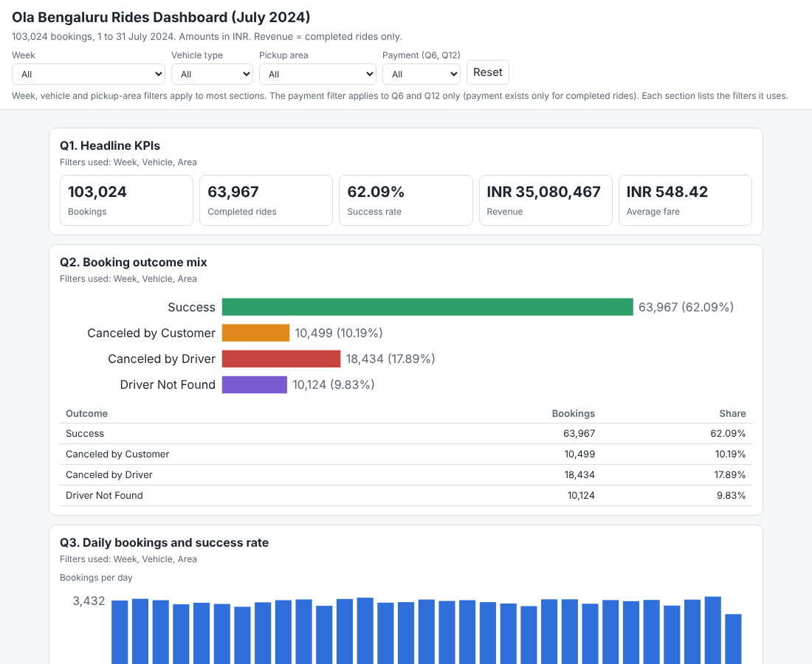
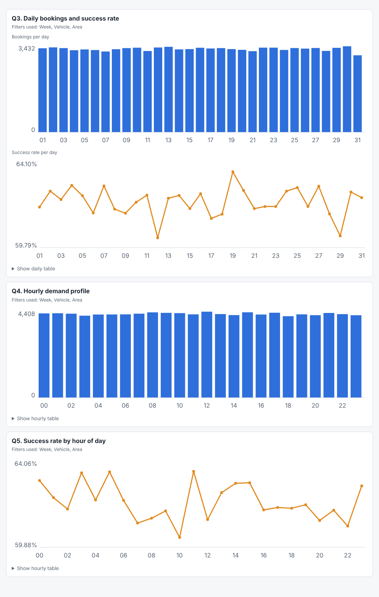
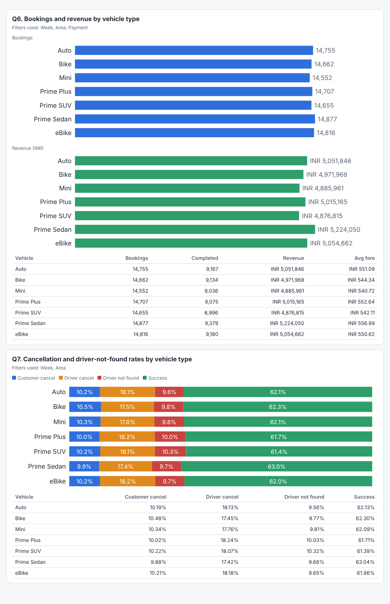
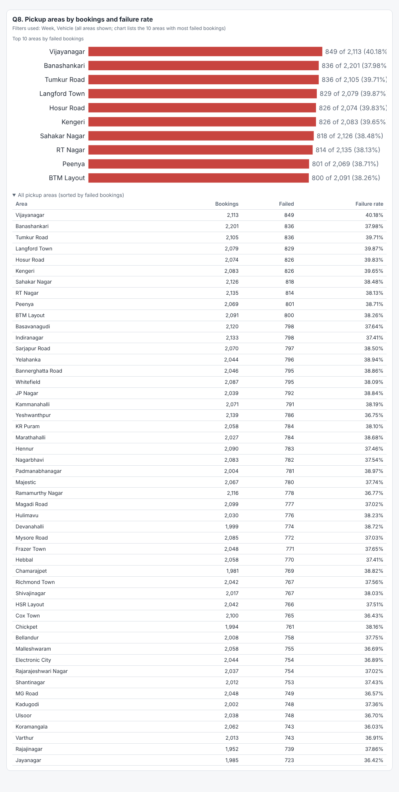
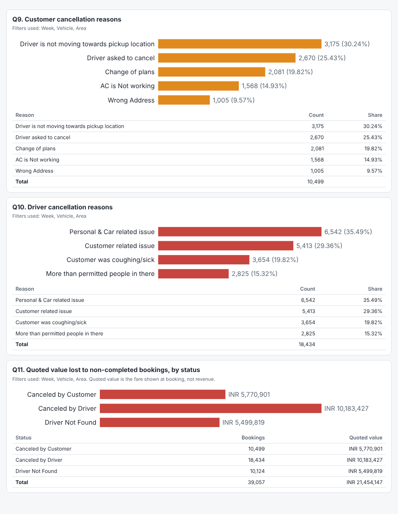
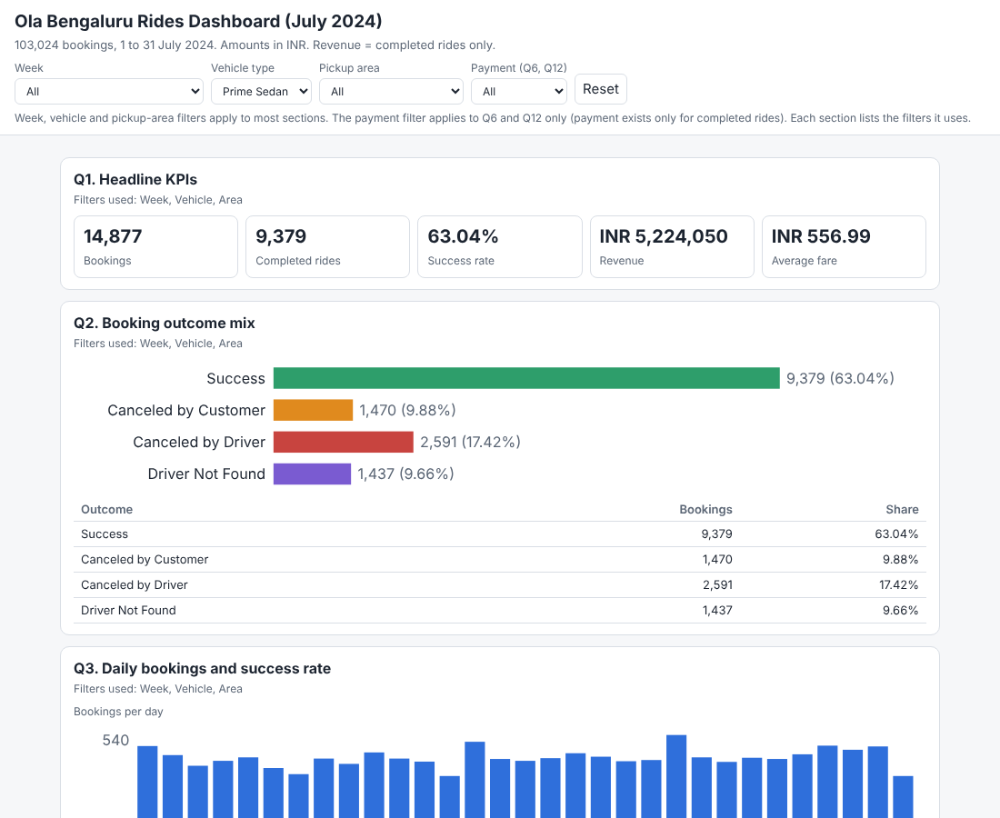
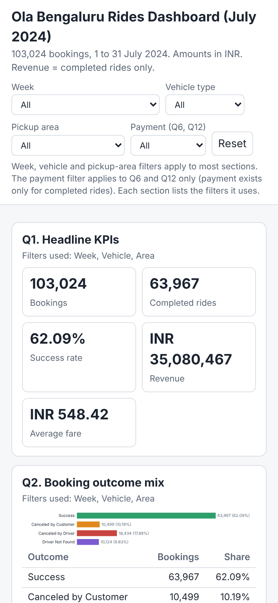

# Ola Bangalore Rides: a data analysis case study

**103,024 ride bookings, one month, 12 leadership questions, answered end to end with a gated, AI-assisted workflow.**
From a raw CSV to a validated Findings document, an Excel dashboard (native PivotTables and slicers) and an offline web dashboard, in 11 approved steps with every decision logged.

> Built by [Munir Suri](https://www.skillmaxx.org) (SkillmaxX) as a teaching example of the *Data Analysis Build* workflow: Claude does the work, a human approves every gate, and nothing moves forward without a log entry.



## The result in 30 seconds

| Metric | Value |
|---|---|
| Bookings (July 2024) | **103,024** |
| Completed rides | **63,967** (success rate **62.09%**) |
| Revenue (completed rides only) | **INR 35,080,467** (average fare INR 548.42) |
| Failed bookings | **39,057** (37.91%) |
| Quoted value lost on failed bookings | **INR 21,454,147** (quoted, not revenue) |

- **Drivers drive the failures.** Driver cancellations are 18,434 bookings (17.89%), customer cancellations 10,499 (10.19%), driver not found 10,124 (9.83%). 55.7% of customer cancellations cite the driver ("driver not moving towards pickup", "driver asked to cancel").
- **No segment stands out.** Success rate stays between 60% and 64% for every vehicle type, hour, day and pickup area. Statistical tests (chi-square) show the differences are within chance (p from 0.07 to 0.87), so rankings of "best" and "worst" segments are arithmetic, not signals.
- **Demand is flat round the clock** (4,176 to 4,408 bookings per hour), so supply needs to be planned for even demand, not a rush hour.
- **Recommendation:** make driver cancellations the first operational target, and confirm with the data owner that the file is a full, unsampled extract (the uniformity is unusual for real ride data).

Full analysis: [`07 Analysis/Findings.md`](07%20Analysis/Findings.md).

## Dashboards

### Web dashboard (offline, filterable)
Open [`09 Web Dashboard/Ola_Rides_Analysis_Web_Dashboard_v1.html`](09%20Web%20Dashboard/Ola_Rides_Analysis_Web_Dashboard_v1.html) in any browser (download it first; GitHub shows source, not the page). Filters: Week, Vehicle type, Pickup area, Payment, plus Reset. 810 KB, aggregated data only, no outside requests.

| Demand and success over time (Q3 to Q5) | Vehicle types (Q6, Q7) |
|---|---|
|  |  |

| Pickup areas (Q8) | Cancellation reasons and value lost (Q9 to Q11) |
|---|---|
|  |  |

| Filtered to one vehicle (Prime Sedan) | On a phone |
|---|---|
|  |  |

### Excel dashboard
[`08 Excel Dashboard/Ola_Rides_Analysis_Dashboard_v2.xlsx`](08%20Excel%20Dashboard/Ola_Rides_Analysis_Dashboard_v2.xlsx): KPI cards on top, four slicers underneath, then a grid of 14 charts, all driven by 12 native PivotTables. Open in desktop Excel, click **Enable Editing**, then **Data > Refresh All**. (Version 1 had the layout of tables on one side and charts on the other; it was rejected in review and rebuilt.)

## The case study: 11 steps

The project follows a gated workflow. Each step produces a document or file, is checked, and needs an explicit approval before the next one starts. The full audit trail is in [`02 Setup and Log/Analysis Log.md`](02%20Setup%20and%20Log/Analysis%20Log.md).

### Step 1. Intake and project setup
Raw file dropped in `Raw Data/` (`ola.csv`, 103,024 rows). A first file turned out to be the wrong one and was replaced before work began. Project rules, a log, a SHA-256 guard on the raw data and a script kit were created. Purpose: a dashboard for leadership; audience: operating managers; both Excel and web outputs.
*Output:* [`PROJECT_RULES.md`](PROJECT_RULES.md), [`02 Setup and Log/`](02%20Setup%20and%20Log/)

### Step 2. Framing
Objective, audience, scope, metric definitions and starter questions written down **before** touching the data. Open points (revenue definition, currency, date handling, what counts as success) were answered and recorded as decisions.
*Output:* [`01 Framing/Framing.md`](01%20Framing/Framing.md)

### Step 3. Data inspection
Structure only, no insights: every column profiled into a data dictionary. The analyst confirmed what the ambiguous fields mean (V_TAT and C_TAT are vehicle and customer turnaround times, probably in seconds; distance in km; one row per booking).
*Output:* [`03 Data Inspection/Data Inspection.md`](03%20Data%20Inspection/Data%20Inspection.md)

### Step 4. Quality audit and relationships
Eleven data-quality issues classified as Class 1 (safe fix), Class 2 (needs a human decision) or Class 3 (cosmetic), plus a key and relationship review. Examples: 39,057 blank ratings and turnaround values on non-completed rides (expected, not errors), zero distances on failed rides, 3,926 rides marked Success but flagged incomplete, and booking values that do not track distance or vehicle type.
*Output:* [`04 Quality Audit/`](04%20Quality%20Audit/)

### Step 5. Cleaning plan, decisions and execution
Plan first, execute after approval. Decisions by the analyst:
- **DQ-05 B:** Success includes the 3,926 flagged-incomplete rides; incomplete stays a separate flag.
- **DQ-06 A:** "Driver Not Found" is its own status.
- **DQ-09 B:** fares kept as recorded; no revenue-per-km or fare-vs-distance views.
- **DQ-10 A:** same-area trips kept and flagged.
- **DQ-11 B:** turnaround seconds shown in minutes (tentative).

The cleaning script ran 28 automated checks (row count unchanged at 103,024, totals before and after identical) and refused to write the file until all passed.
*Output:* [`05 Cleaning and Prep/`](05%20Cleaning%20and%20Prep/)

### Step 6. Question bank
60 candidate questions across descriptive, diagnostic, trend, segment, anomaly and decision types, 59 answerable from the data. Twelve were selected for the dashboard.
*Output:* [`06 Question Bank/Question Bank.md`](06%20Question%20Bank/Question%20Bank.md)

| | Dashboard question |
|---|---|
| Q1 | Headline KPIs |
| Q2 | Booking outcome mix |
| Q3 | Daily bookings and success rate |
| Q4 | Hourly demand profile |
| Q5 | Success rate by hour |
| Q6 | Bookings and revenue by vehicle type |
| Q7 | Cancellation and not-found rates by vehicle type |
| Q8 | Pickup areas by bookings and failure rate |
| Q9 | Customer cancellation reasons |
| Q10 | Driver cancellation reasons |
| Q11 | Quoted value lost, by status |
| Q12 | Turnaround time and ratings by vehicle type |

### Step 7. Analysis base and findings
An analysis workbook with a native PivotTable and slicers for every question, and a Findings document where **every number is validated** against an independent pandas calculation. Findings include statistical tests, so that flat segment differences are not over-read.
*Output:* [`07 Analysis/`](07%20Analysis/)

### Step 8. Excel dashboard
One Dashboard sheet with KPI cards, slicers, charts and a coverage table, reading the PivotTables with GETPIVOTDATA. The first version put tables on one side and charts on the other and was rejected as not dashboard-like; it was redone from scratch with a proper layout. The integrity check confirms 12 PivotTables, 4 slicers, 14 charts, and the saved KPI values match Findings.
*Output:* [`08 Excel Dashboard/`](08%20Excel%20Dashboard/)

### Step 9. Web dashboard
Plain HTML, CSS and JavaScript with inline SVG charts, built from aggregated JSON only (no row-level or customer data). Tested in a headless browser: 16 checks (no console errors, no external requests, 358 values compared with pandas across the unfiltered page and four filter combinations, Reset works).
*Output:* [`09 Web Dashboard/`](09%20Web%20Dashboard/)

### Step 10. Publish and handoff
Published as a private Claude artifact (after explicit approval) and documented: file inventory, how to use, how to refresh with new data, decisions, known limitations.
*Output:* [`10 Dash Handoff/Handoff.md`](10%20Dash%20Handoff/Handoff.md)

### Step 11. Move to GitHub
The whole project, including the audit trail, moved into this repository with this README as the case-study front page.

## How the workflow keeps AI honest
- **Gates:** no step starts until the previous one has an `APPROVAL` row in the log.
- **Raw data is read-only:** a SHA-256 guard runs at the start and end of every step.
- **Questions for humans:** Class 2 issues are put to the analyst as multiple-choice decisions, not guessed.
- **Numbers are re-derived:** every dashboard value is compared with an independent calculation before it is shown.
- **Candour about what was not checked:** the Excel repair-prompt check and the user's own phone test are listed as open items rather than assumed.

## Repository map
```
Raw Data/                 source CSV (read-only)
01 Framing/               objective, scope, decisions
02 Setup and Log/         analysis log, project config, script kit
03 Data Inspection/       data dictionary
04 Quality Audit/         DQ issues, relationships
05 Cleaning and Prep/     plan, script, cleaned data
06 Question Bank/         60 questions, 12 selected
07 Analysis/              analysis base, Findings.md
08 Excel Dashboard/       Dashboard_v2.xlsx (rejected v1 not included)
09 Web Dashboard/         standalone .html, build and test scripts
10 Dash Handoff/          handoff document
docs/images/              screenshots used in this README
```

## Reproduce
```bash
pip install pandas openpyxl numpy playwright && playwright install chromium
python "05 Cleaning and Prep/clean_data.py"
python "02 Setup and Log/kit/scripts/pivot_builder_dash2.py" --spec "07 Analysis/analysis_spec.json" --mode v1 --dashboard --out "08 Excel Dashboard/Ola_Rides_Analysis_Dashboard_v2.xlsx"
python "09 Web Dashboard/build_web.py"
python "09 Web Dashboard/tests/test_web.py" --dir "09 Web Dashboard"
```

## Limitations
- One month of data (July 2024); the week of 29 July has 3 days. No trend over time can be shown.
- Fares do not follow distance or vehicle type in this file, so revenue-per-km views are deliberately absent.
- Turnaround unit (seconds) is the analyst's tentative reading.
- Segment patterns are unusually flat; confirm the extract is complete and unsampled before acting on segment-level differences.
- The raw file contains customer IDs, which is why this repository is private. Dashboards contain aggregates only.

## Licence and data
Source data: Ola Bengaluru ride bookings, July 2024, as supplied by the author. Do not redistribute the raw file.
